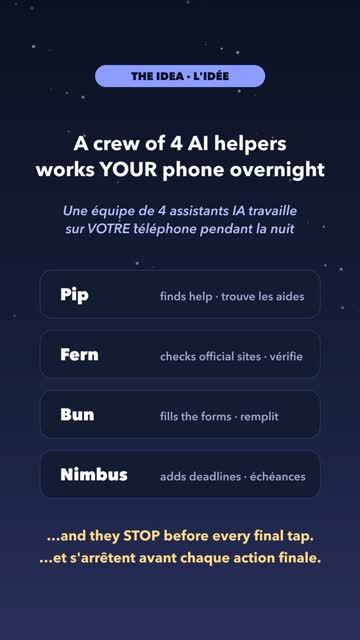
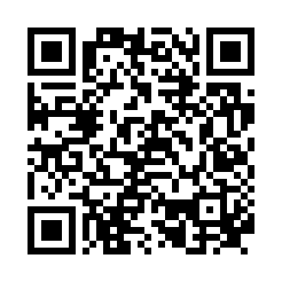

# 🌙 Benefeed Night Shift

🇬🇧 [English](README.md) · 🇫🇷 **Français**

### Vous êtes en Ne pas déranger. Votre équipe, non.

Une équipe de quatre assistants IA travaille la nuit **sur un vrai téléphone** : elle remplit une demande d'aide, ajoute les échéances à l'agenda et rédige un message pour un proche. Puis elle **s'arrête avant chaque action finale** et attend votre oui.

[**🌐 Site du projet (3D)**](https://arushish5-cyber.github.io/benefeed-nightshift/about/) · [**▶ Ouvrir l'app**](https://arushish5-cyber.github.io/benefeed-nightshift/?demo&fr)

 · [🎬 Vidéo (thème nuit)](docs/benefeed-explainer-night.mp4) · [🎬 Vidéo (thème jour)](docs/benefeed-explainer-light.mp4)

&nbsp;&nbsp;

## Le problème
Aux États-Unis, **9,1 millions de personnes âgées ratent environ 58 milliards de dollars d'aides par an** (NCOA). Elles ne ratent pas ces aides par manque d'intérêt : demander, c'est se battre avec des portails, des menus déroulants et des échéances sur un petit écran.

## L'équipe
| | |
|---|---|
| 🐦 **Pip** (chercheur) | Trouve vos aides à partir de trois questions. Sans compte, sans n° de sécu. |
| 🐸 **Fern** (vérificatrice) | Vérifie chaque info sur les sites officiels avec **Tavily** et garde la citation exacte. |
| 🐰 **Bun** (formulaires) | Remplit la demande **sur le téléphone lui-même** (portail d'entraînement). |
| ☁️ **Nimbus** (rappels) | Ajoute les échéances à l'agenda, avec le lien officiel. |

## L'automatisation, en vrai
Une vraie exécution enregistrée, pas une maquette : **Claude, piloté par notre graphe LangGraph**, remplit les 4 écrans du portail (foyer, revenus, contact), puis **s'arrête tout seul à 🔒 « Envoyer »**. Après votre **oui**, il reprend, appuie sur Envoyer puis Confirmer, et le portail enregistre la demande.

**Boucle :** observer l'écran → décider (Claude, parmi 9 actions sûres) → agir (PhoneUse tape et écrit) → revérifier. Si c'est le bouton final, le garde-fou lève un `HardStop` et LangGraph fait un `interrupt()`.

## Vous gardez la main
1. L'équipe s'arrête toute seule avant Envoyer, Ajouter ou Payer.
2. Au matin, une notification : « 3 choses vous attendent ».
3. Vous revoyez chaque capture d'écran.
4. Vous **maintenez 1,2 s** pour dire oui. « Passer » n'appuie jamais ; « Modifier » refait la tâche.

## Pays et niveaux
🇺🇸 États-Unis (20 aides) · 🇫🇷 **France** : APL, Prime d'activité, RSA, Complémentaire santé solidaire, ASPA, Chèque énergie · 🇬🇧 Royaume-Uni (4). Chaque carte indique son niveau (🏛️ Fédéral / National, 🗺️ État, 🏘️ Local) et sa source officielle. L'app passe de l'anglais au français d'un geste.

## Pourquoi c'est différent
| | Sites d'aides | Chatbots | **Benefeed** |
|---|:-:|:-:|:-:|
| Trouve vos aides | ~ | ~ | ✅ |
| Remplit les formulaires | ❌ | ❌ | ✅ |
| Agit dans de vraies apps | ❌ | ❌ | ✅ |
| Attend votre oui | – | ❌ | ✅ |
| Source officielle pour chaque info | ✅ | ❌ | ✅ |

## Sécurité, dans le code
Arrêt obligatoire avant toute action finale · 3 apps autorisées, sites officiels seulement · le texte d'une page n'est jamais un ordre (page piégée `/practice/evil` ignorée) · 40 étapes et 3 minutes maximum par tâche, bouton Stop · données fictives (Rosa, 68 ans), captures effacées en 24 h · **25 tests** de sécurité.

## Construit avec
**PhoneUse** (les mains de l'équipe : un vrai téléphone dans le cloud, piloté par MCP) · **LangGraph** (le cerveau et `interrupt()`) · **Claude** · **LangSmith** · **Tavily** · **ElevenLabs** · **GitHub Pages**.

> 💛 **Merci PhoneUse.** Cette démo n'existe que grâce à ce que vous avez construit : donner de vraies mains à une IA, en toute sécurité.

Construit seule au Do Not Disturb Hackathon × PhoneUse, San Francisco, 13 novembre 2026.
