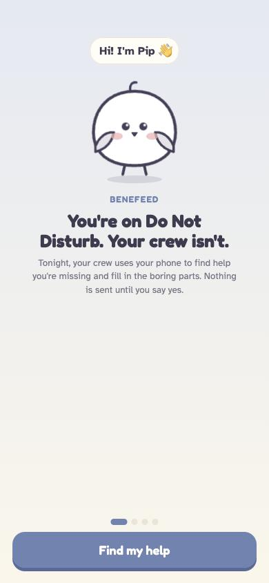

# 🌙 Benefeed Night Shift

**You're on Do Not Disturb. Your crew isn't.**

Millions of people miss benefits they qualify for, because applying means fighting forms on a small screen (NCOA estimates 9.1M older adults miss about $58B a year).
Benefeed's crew of four helpers (Pip, Fern, Bun and Nimbus) works overnight **on your real iPhone through PhoneUse**. They fill in the application, add deadlines to Calendar and draft a text to a family helper. Then they **stop before every final tap**. In the morning you get one card: *"3 things are ready. Say yes."*



## Why it stands out
- **Real phone, real apps.** The work happens in Safari, Calendar and Messages on an actual iPhone, not in a chatbot window.
- **The hard stop is in code, not in a prompt.** Submit, Send and Add trigger a LangGraph `interrupt()`. No code path taps them without an approval record from the server.
- **Works for judges anywhere.** Install the PWA from the QR code. When the phone is offline you see a clearly labelled **Replay** of a real run.

## Sponsors and their jobs
| Sponsor | Job |
|---|---|
| **PhoneUse** | The crew's hands on the real iPhone (live screenshots, filmstrip) |
| **LangGraph** | The crew's brain and the `interrupt()` before every final tap |
| **LangSmith** | Traces every run ("See trace ↗") |
| **Tavily** | Fern checks facts on official .gov domains only and saves the exact quote |
| **ElevenLabs** | Pip's morning briefing and the Spanish voice note |
| **Replit** | Hosts the server and PWA, so you can open it on any phone |

## Architecture
```
iPhone ─USB─ Mac: PhoneUse API 127.0.0.1:8765 (loopback only)
                 └─ runner/ (Python, LangGraph) ── outbound HTTPS + RUNNER_SECRET ──▶
Replit: server/ (FastAPI + SQLite) serves web/ (React PWA), /practice portal, API
                 ▲ judges' phones (installed PWA)
```

## Safety
1. A hard stop in code before Submit, Send, Pay, Delete and Add.
2. An app allowlist: Safari, Calendar and Messages only. URLs are limited to the practice portal and .gov domains.
3. Screen text is treated as data, never as instructions.
4. Only a practice portal (labelled "NOT A REAL AGENCY") gets test data. No real agency does.
5. Limits: 40 steps and 3 minutes per task. **Stop** releases the phone.
6. Keys stay server-side, PhoneUse never leaves the Mac, and only the owner link can drive the live phone.
7. The demo uses a test persona only. The app blocks SSNs, phone numbers and addresses in posts. Screenshots are deleted after 24 h.

## Run it
```bash
cd web && npm ci && npm run build && cd ..
uv run uvicorn server.app:app --port 8090        # server + PWA
uv run python -m runner.smoke                     # PhoneUse check (needs Xcode + WDA running)
RUNNER_SECRET=... BENEFEED_SERVER=https://<replit-url> uv run python -m runner.heartbeat
```
Environment variable names are listed in `.env.example`. Put the values in Replit Secrets and never commit them.
